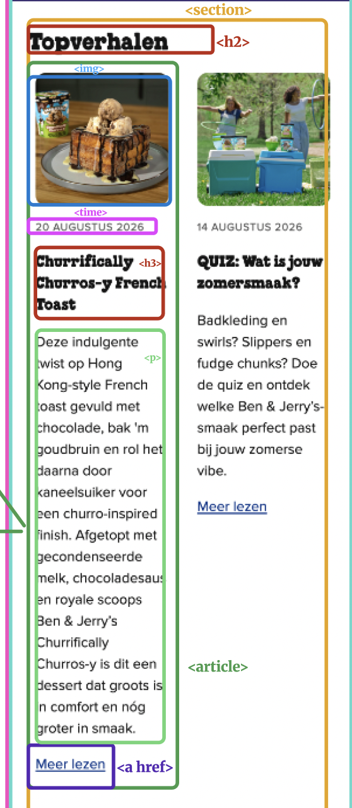
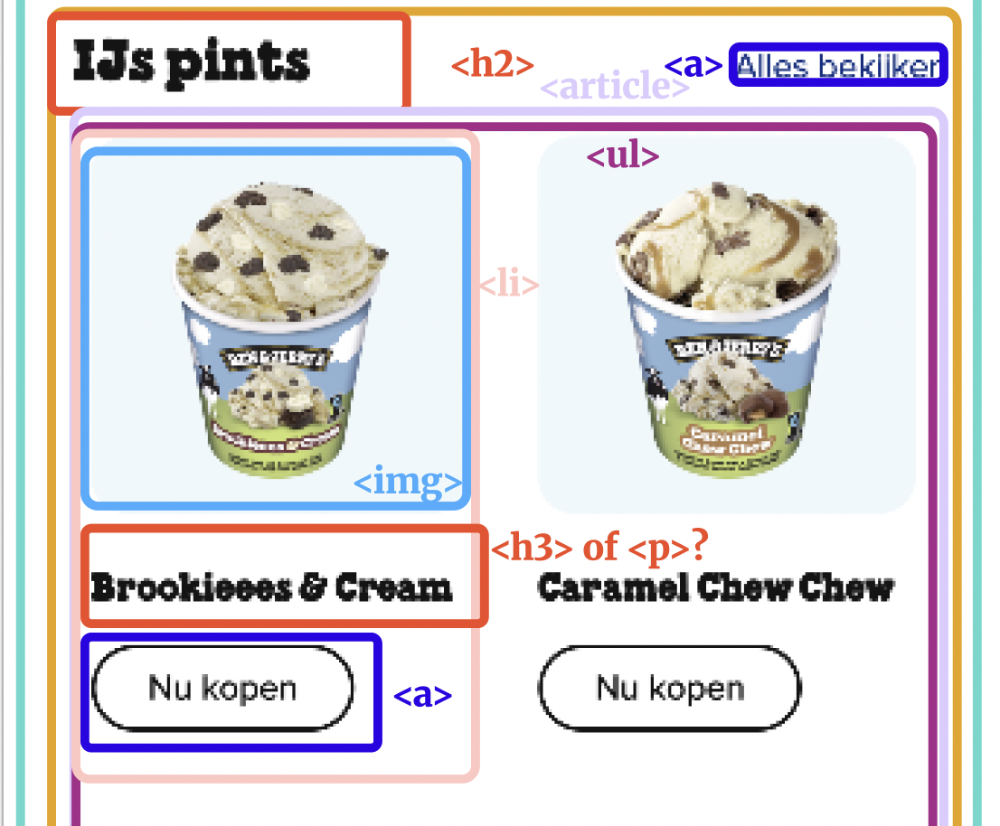
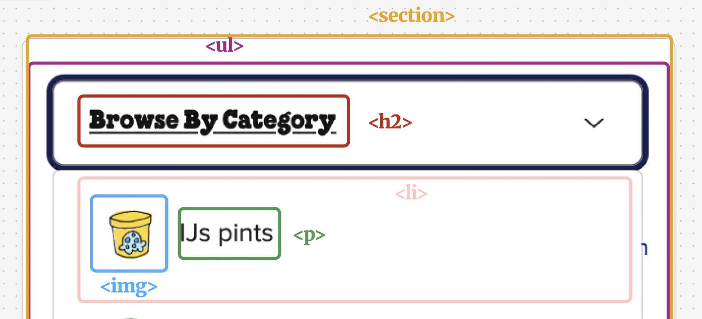
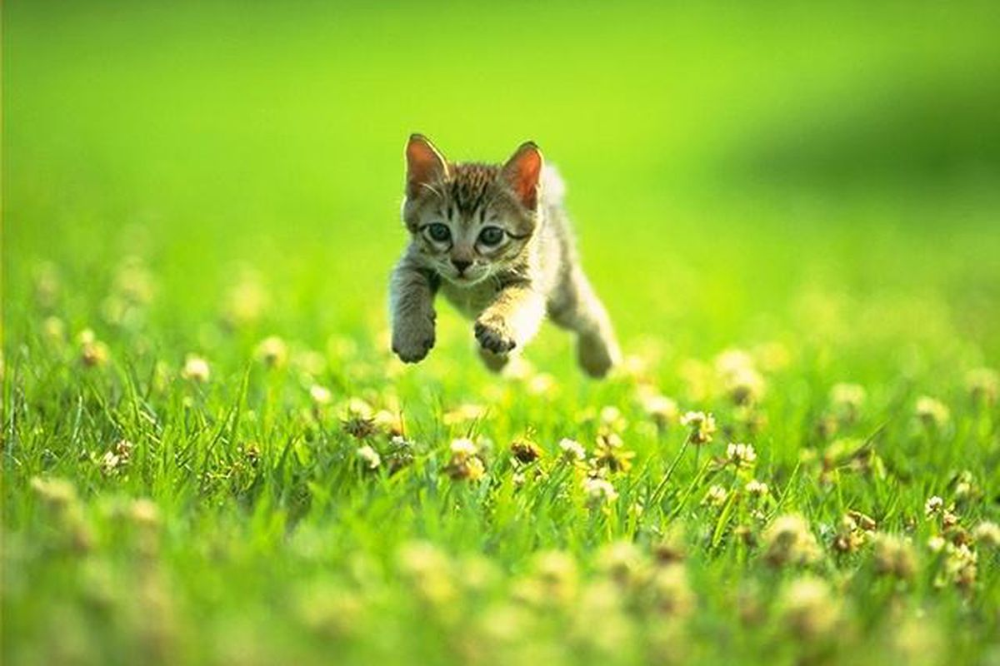

# Procesverslag
Markdown is een simpele manier om HTML te schrijven.  
Markdown cheat cheet: [Hulp bij het schrijven van Markdown](https://github.com/adam-p/markdown-here/wiki/Markdown-Cheatsheet).

Nb. De standaardstructuur en de spartaanse opmaak van de README.md zijn helemaal prima. Het gaat om de inhoud van je procesverslag. Besteedt de tijd voor pracht en praal aan je website.

Nb. Door *open* toe te voegen aan een *details* element kun je deze standaard open zetten. Fijn om dat steeds voor de relevante stuk(ken) te doen.

## Jij

  
uitwerken voor kick-off werkgroep

  ### Auteur:
  Samya El Ghazi

  #### Je startniveau:
  Blauwe piste. Ik vind programmeren erg lastig.

  #### Je focus:
  Focus ligt op responsiveness
 

## Je website

  
uitwerken voor kick-off werkgroep

  ### Je opdracht:
  https://www.benjerry.nl/

  #### Screenshot(s) van de eerste pagina (small screen): 
  Startpagina
  

  #### Screenshot(s) van de tweede pagina (small screen):
  Onze smaken  
  
 

## Toegankelijkheidstest 1/2 (week 1)

  
uitwerken na test in 2e werkgroep

  ### Bevindingen
  Lijst met je bevindingen die in de test naar voren kwamen:
  - Contrasten zijn goed ontworpen voor mensen die kleurenblind zijn. Er worden duidelijke kleuren gebruikt die verschillende states aangeven
  - Slechtziend: scoort hier ook wel goed op. Grote plaatjes, knoppen en letters geven duidelijk weer wat de elementen op de website doen en betekenen. Tekst is groot vormgegeven. Maakt het leesbaar voor een gebruiker.
  - Spasmes: De knoppen en klikbare functies zijn groot ontworpen, dus er is veel beweegruimte. Sommige knoppen mogen voor consistentie in de website misschien nog iets groter vormgegeven worden.

  Voiceover Ben & Jerry’s:
  - Link met ga naar de hoofdinhoud is aanwezig
  - Slaat navigatie over (hoort dit?)
  - Benoemt links en knoppen en artikels.
  - Benoemt tekstveld en dat er daar een e-mail ingevuld moet worden
  - Benoemt de lijst met vlaggen drop-down 
  - Benoemt de lijst met social media links. Zegt ook hoeveel onderdelen er in het lijstje zitten
  - Slaat images over

  ### WCAG lijst
  Tijdens de les hebben in duo's elkaars website bekeken. Ik heb Lisa's website Claire's bekeken.

## Breakdownschets (week 1)

  
uitwerken na afloop 3e werkgroep

  ### de hele pagina: 

  Link naar de breakdown schetsen: https://www.figma.com/board/XfraMFkKXsVunC72MxdpcF/Samya_breakdownschetsen_ben-jerry-s?node-id=0-1&t=FBKOxpDlHpKeiLog-1

  ### dynamisch onderdeel (topverhalen): 
  

  ### dynamische onderdeel (ijssmaken): 
  

  ### dynamische onderdeel (dropdown filter): 
  

## Voortgang 1 (week 2)

  
uitwerken voor 1e voortgang

  ### Stand van zaken
  Het structureren van de html gaat denk ik wel goed. Ik heb bij een aantal onderdelen wel wat vragen. Ik heb bijvoorbeeld vragen of ik goede code gebruik, of iets makkelijker kan dan ik nu heb gedaan, en welke codes ik moet gebruiken voor email en search labels.

  ### Agenda voor meeting

  Student 1: Samya
  Website: Ben & Jerry’s
  Pagina’s die ik ga maken: Homepagina en Smaken pagina
  
  Vragen die ik tijdens de voortgang wil bespreken:

  - De nav heeft een drop-down op mobiel, ipad en desktop. Is hier een html tag voor of is dit iets voor css?

  - Ik heb alle titels een h2 gegeven en alle subtitels een h3, klopt dit op volgorde of moet ik ook h4’s en h5’s gebruiken?
  
  - Sommige iconen (menu icon, social media icons) op mijn website zijn spans en geen images die ik in mijn html kan zetten. Kan ik de spans gebruiken of is er een andere manier om deze iconen weer te geven op mijn website? Moeten de iconen ook aanpasbaar zijn voor light en dark mode?
  
  - Op de “Smaken” pagina heb ik nu de content in verschillende sections en articles gestopt. Is dit handig, of moet ik alles juist in 1 section stoppen, met daarin meerdere articles, met daarin een ul li?
  
  - Op de “Smaken” pagina veranderd de eerste image bovenaan de pagina. Op mobiel is er bijvoorbeeld geen animatie, en staat het ijsje in het midden. Op iPad en Desktop schuift het ijsje naar de rechterkant van de pagina en zijn de pijlen geanimeerd. Hoe schrijf ik deze images responsive in de html?

  ### Verslag van meeting
  hier na afloop snel de uitkomsten van de meeting vastleggen

  - Vraag 1: Details en summary gebruiken, binnen de details een ul li gebruiken voor de nav elementen
  - Vraag 2: De titels kloppen, zo houden
  - Vraag 3: Zoek naar iconene die lijken op die van de ben & jerry's website, download ze als svg's.
  - Vraag 4: Goede volgorde aangehouden, sections id's geven zodat je met het drop-down filter kunt scrollen naar de juiste sectie op de pagina
  - Vraag 5: Picture element gebruiken. In deze code kun je de images aanpassen binnen elke media query.

## Voortgang 2 (week 3)

  
uitwerken voor 2e voortgang

  ### Stand van zaken
  Ik moet nog best veel doen aan de css, en er is veel wat ik nog lastig vind. Ik merk aan mezelf dat ik van beneden naar boven werk in de css, wat niet zo handig is. Dit moet ik in de komende weken verbeteren.

  ### Agenda voor meeting
  
  Mijn vragen:

  - Voor de derde section heb ik nu display flex gebruikt. Hoe krijg ik de items net als op de echte ben en jerry's website? Kan ik beter display grid gebruiken?
  - Hoe maak ik binnen in mijn nav nog een drop-down?
  - In mijn footer heb ik een drop-down met vlaggen van verschillende landen. Hoe krijg ik de vlaggetjes in de drop-down?
  - Hoe werk ik de witruimtes tussen sections weg?
  - In de footer heb ik een input type email, hoe zet ik dat pijltje in de button?

  ### Verslag van meeting
  hier na afloop snel de uitkomsten van de meeting vastleggen

  - Vraag 1: geen display flex gebruiken, gebruik display grid. Dit maakt het makkelijker met het responsive maken van deze sectie
  - Vraag 2: binnen de li nog een details tag gebruiken
  - Vraag 3: select en option tag gebruiken
  - Vraag 4: margin en padding van de ul op 0 zetten
  - Vraag 5: svg in de css zetten met content url()

## Toegankelijkheidstest 2/2 (week 4)

  
uitwerken na test in 9e werkgroep

  ### Bevindingen
  Lijst met je bevindingen die in de test naar voren kwamen (geef ook aan wat er verbeterd is):

## Voortgang 3 (week 4)

  
uitwerken voor 3e voortgang

  ### Stand van zaken
  Ik moet nog echt aan de bak en verder met mijn code, ik ben nog niet waar ik had willen zijn.

  ### Agenda voor meeting
  Online voortgang met Lisa en Danny.
  - Vraag 1: Op de smaken pagina heb ik bij de header images 2 images die overlappen (op mobiel) en een background color. Ik heb hiervoor de picture tag gebruikt, maar ik krijg de picture niet te zien. Hoe los ik dit op?
  - Vraag 2: Hoe laat ik de link scrollen naar de juiste sectie in het drop down filter?

  ### Verslag van meeting
  hier na afloop snel de uitkomsten van de meeting vastleggen

  - Vraag 1: Danny heeft dit opgelost :D
  - Vraag 2: Door in de a de id van de sectie neer te zetten. Hiervoor ook een code zoeken die smooth naar beneden scrolld

## Eindgesprek (week 5)

  
uitwerken voor eindgesprek

  ### Je uitkomst - karakteristiek screenshots:
  

  ### Dit ging goed/Heb ik geleerd: 
  Ik heb veel plezier gehad met het stylen van de ben & jerry's website. Het was oprecht leuk om eraan te werken en ik heb veel geleerd over het gebruiken van flexbox en grid.

  

  ### Dit was lastig/Is niet gelukt:
  Helaas heb ik de website niet af gekregen. Er zijn nog echt een aantal dingen die ik moet gaan maken. Apart hiervan, missen veel plaatjes nog een alt tag en is mijn bronvermelding nog niet af. De toegankelijkheidstest is ook nog niet uitgevoerd, omdat de website nog niet af was. De website mist ook een dark-mode optie.

  

## Eindgesprek herkansing

  
uitwerken voor eindgesprek

  ### Je uitkomst - karakteristiek screenshots:
  

  ### Dit ging goed/Heb ik geleerd: 
  Ik heb veel plezier gehad met het stylen van de ben & jerry's website. Het was oprecht leuk om eraan te werken en ik heb veel geleerd over het gebruiken van flexbox en grid. Ik heb nu ook voor het eerst echt een dark-mode van een website gemaakt.

  Naast het coderen van de website van ben & jerry's en het vormgeven op dezelfde manier, heb ik zelf een paar design keuzes gemaakt voor de vormgeving.
  - De footer heb ik linear gelaten voor tablet/iPad. Ik heb dit gedaan om de informatie overzichtelijk te houden. Elementen naast elkaar zetten op dit scherm vond ik onnodig, en zorgt voor ruis en onoverzichtelijkheid. Dat is mijn mening. Vanaf een groter formaat staan de elementen wel naast elkaar met display grid.
  - Voor de nav heb ik de keuze gemaakt om de nav op mobiel en tablet/desktop consistent te houden. Vanaf dektop verdwijnt de menu icon en komen de menu items naast elkaar te staan met display flex.
  - In de footer heb ik ervoor gekozen om toch geen imgs van de vlaggen te gebruiken. In de select form > option value heb ik emoji's gebruikt. Ik heb eerst onderzoek gedaan naar digitale toegankelijkheid van emoji's, en of ze door screenreaders gelezen worden. Emoji's worden gelezen door screenreaders. In de bronvermelding heb ik een link staan naar het artikel.

  

  ### Dit was lastig/Is niet gelukt:
  Korte omschrijving met plaatjes

  

## Bronnenlijst

  
continu bijhouden terwijl je werkt

  Nb. Wees specifiek ('css-tricks' als bron is bijv. niet specifiek genoeg). 
  Nb. ChatGpT en andere AI horen er ook bij.
  Nb. Vermeld de bronnen ook in je code.

  1. Label en input type codes: https://www.w3schools.com/tags/att_input_type_search.asp
  2. Claude voor het berekenen van de vw van de header
  3. Bron voor het gebruiken van vlaggetjes emoji's in de landen select form in de footer: https://digitaaltoegankelijk.nl/nieuws/digitaal-toegankelijk-gebruik-van-emojis/
  4. StackOverflow, om de pijltjes in de nav te verbergen: https://stackoverflow.com/questions/6195329/how-can-you-hide-the-arrow-that-is-displayed-by-default-on-the-html5-details-e
  5. Hamburgermenu, van de opdracht in codepen: https://codepen.io/shooft/pen/NPGXJGq
  6. filter: invert(); code om mijn iconen wit te maken in dark mode van https://css-tricks.com/almanac/functions/i/invert/

